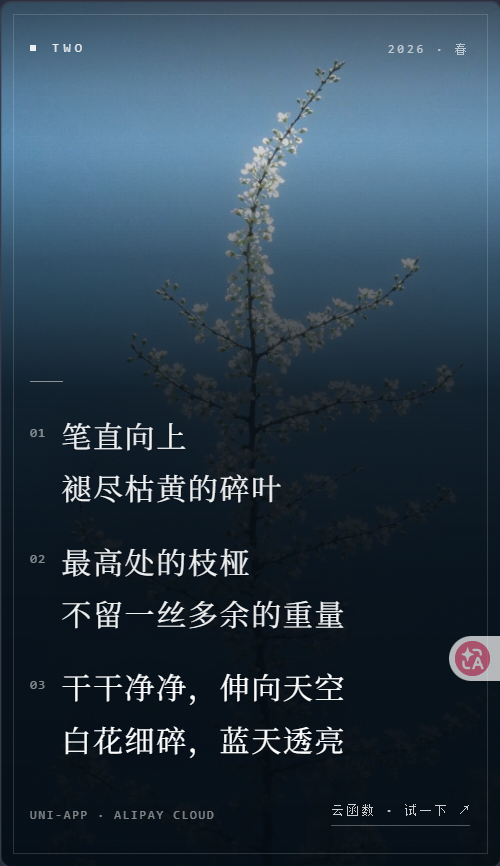

# achievement_box

一个私人小仓库：自己写的两个 Windows 桌面小工具，加一些换机时想留着的资料。

**摘要**：能跑的自研工具有两个——PyQt5 写的桌宠（带工具箱）、纯标准库写的桌宠（点击复制）；其余目录只存链接、截图和本地资料，没有可运行代码。数据全部落在本地 JSON 和纯文本里，不联网、不上数据库。

| 类型 | 数量 | 说明 |
| --- | --- | --- |
| 自研工具 | 2 个 | 双击即用，`.bat` / `.pyw` 启动 |
| 资料留存 | 7 项 | 链接与截图为主，换机时可对照找回 |

## 目录

```
achievement_box/
├─ README.md
└─ tools/
   ├─ 工具箱桌宠/                     # 自研 · 桌宠 + 多工具面板
   │  ├─ bot0.5/                      #   v0.5 只有记事本
   │  ├─ bot1.0/                      #   v1.0 加软件箱
   │  └─ bot1.1/bot/                  #   v1.1 当前主线
   ├─ 左键直接复制/DesktopPet/         # 自研 · 点一下把预设文字送进剪贴板
   ├─ ladder/                         # 资料 · 网络工具本地留存
   ├─ 截图工具/                       # 资料 · 截图软件地址
   ├─ 自动化测试/                     # 资料 · 测试报告工具
   ├─ 类似postman的发送请求工具/       # 资料 · 接口调试工具截图
   ├─ qq企鹅/                         # 参考 · 开源桌宠截图
   ├─ ai制作网页新思路/                # 参考 · 前端实践截图
   └─ 生图生视频idea/                  # 参考 · 素材与灵感
```

> 可运行代码只在 `工具箱桌宠/` 和 `左键直接复制/` 里；其余目录点进去是链接或图片。

## 自研工具

### 一、桌宠 + 工具箱（`tools/工具箱桌宠/`）

桌面上站着一只桌宠，不挡事、会轻轻浮动。左键点开工具箱，右键调大小、退出。

- 无边框、全透明、始终置顶，可拖动；空闲时正弦浮动，点一下会弹一下并说句话
- 右键滑块缩放 50% – 250%，以右下角为锚点，下次启动记住
- 工具箱左侧切换工具、右侧内容区，带淡入淡出

| 工具 | 做什么 |
| --- | --- |
| 📝 记事本 | 随手记一句，存成 `notes/年/月/日/时_分.txt`，上限 5000 字 |
| 📦 软件箱 | 桌面式启动面板，双击图标起 `.exe`，可换图标、改路径、删除 |

数据都落在 JSON 里，改坏了删掉即恢复默认：`assets/software_list.json`（软件列表）、`assets/scale.json`（缩放比例）、`notes/`（记事内容）。

| 版本 | 变化 |
| --- | --- |
| v0.5 | 跑通透明窗口、置顶、缩放，只有记事本 |
| v1.0 | 抽出工具基类与注册表，工具箱可扩展，加软件箱 |
| v1.1 | 代码收进 `bot/`；修掉反复开关导致的窗口叠加；启动异常写 `pet_error.log`；软件项改用唯一 id |

**运行**：`pip install PyQt5` 后双击 `启动桌宠.bat`（或 `python main.py`）。启动脚本按序找 Python：项目内 `runtime\python\pythonw.exe` → 沙箱自带运行时 → 系统 PATH。因为静默启动看不到报错，出错请看同目录 `pet_error.log`。

**加一个工具**：在 `tools/` 下继承 `BaseTool`，写好 `name` / `icon` / `get_widget()`，再在 `tools/__init__.py` 里注册进 `TOOL_REGISTRY` 即可；需要时重写 `on_show` / `on_hide` / `on_close` / `refresh`。

### 二、点击直接复制（`tools/左键直接复制/DesktopPet/`）

另一只桌宠：不记事，只把一段固定内容随时递到剪贴板。屏幕上一个小球，左键一点内容立刻进剪贴板，不弹提示窗。

- **零依赖**：`tkinter` + `ctypes`，不用 `pip install`
- **透明穿透**：分层窗口色键，球以外区域能点穿，不挡桌面图标
- **可设置**：右键改内容（支持多行）、选 7 种形状、12 种颜色，实时预览
- **拖得动**：拖动超过 4 像素算移动，不会误触发复制；位置自动记住
- **关掉还在**：走 Win32 原生剪贴板，退出后内容仍保留
- **单实例**、**高 DPI** 缩放下大小一致不发虚

| 文件 | 作用 |
| --- | --- |
| `desktop_pet.pyw` | 主程序，单文件 |
| `启动桌宠.bat` / `启动桌宠(无黑框).vbs` | 双击启动 / 静默启动 |
| `pet_config.json` | 自动生成，存内容、形状、颜色、位置 |

操作：左键复制 · 拖动移动 · 右键开面板 · `Ctrl + Enter` 完成 · `Esc` 关闭不保存。

> 更细的说明（开机自启、改大小、恢复默认、常见问题）在同目录那份 README 里。

## 资料留存

不是代码，是「换机还想装、以后还想再看一眼」的东西。

| 目录 | 内容 |
| --- | --- |
| `ladder/` | 网络工具本地留存（二进制，体积较大） |
| `截图工具/` | 截图软件地址 |
| `自动化测试/` | 测试报告工具地址与版本截图 |
| `类似postman的发送请求工具/` | 接口调试工具界面截图 |
| `qq企鹅/` | 开源桌宠项目截图 |
| `ai制作网页新思路/` | 前端实践资料截图 |
| `生图生视频idea/` | 素材与灵感整理 |

## 技术栈

- **Python 3** · PyQt5（`QWidget` 自绘、`QPropertyAnimation`、`QStackedWidget`）
- **Python 3** · tkinter + ctypes（零第三方依赖那版）
- **Win32**：分层窗口色键、`SetWindowPos(HWND_TOPMOST)`、`OpenClipboard` / `SetClipboardData`、`SetProcessDpiAwareness`
- **数据**：本地 JSON + 纯文本

## 快速开始

```powershell
git clone <本仓库地址>
cd achievement_box
```

- 桌宠 + 工具箱 → 进 `tools\工具箱桌宠\bot1.1\bot\`，`pip install PyQt5`，双击 `启动桌宠.bat`
- 点击复制 → 进 `tools\左键直接复制\DesktopPet\`，双击 `启动桌宠.bat`（想要无黑框就双击 `.vbs`）

两只桌宠可以同时开着，互不干扰。

### **三、nuicloud小项目**
1. 一个简单的页面
   1. 电脑端 
   
   2. 手机端
   
   
2. 浏览网址是: https://env-00jy73aay3sd-static.normal.cloudstatic.cn/

## 说明

个人自用项目，未指定开源协议；第三方软件与项目的版权归各自作者，这里只做资料留存和截图引用；桌宠形象仅作本机使用。

如果这些代码恰好帮到你，随便拿去改。